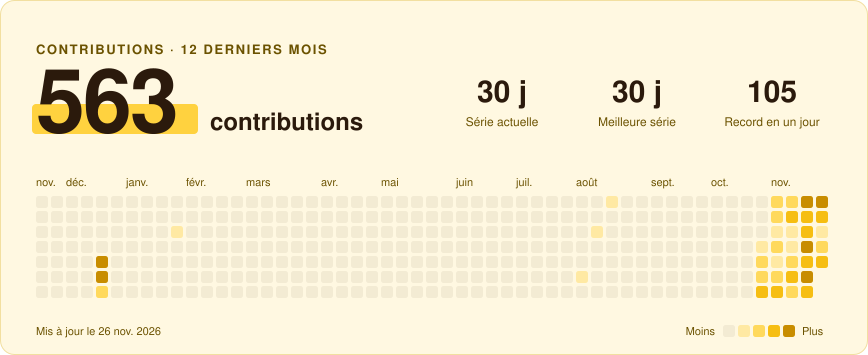

<a href="https://klavo.fr"><picture>
  <source media="(prefers-color-scheme: dark)" srcset="https://readme-typing-svg.demolab.com?font=Bricolage+Grotesque&weight=700&size=24&duration=3000&pause=1000&color=FFD23F&center=true&vCenter=true&width=520&lines=Sites+internet+livr%C3%A9s+en+7+jours;Score+Google+95%2B;Des+sites+qui+ram%C3%A8nent+des+clients" />
  
</picture></a>

## Salut 👋, moi c'est Simon

> *Don't be a programmer, Be a problem solver.*

Je dirige **[Klavo](https://klavo.fr)**, une agence web à Paris. On crée des sites pour les commerces, les indépendants et les PME d'Île-de-France : maquette en 1 à 2 jours, mise en ligne en 7 jours, score Google au-dessus de 95.

Ce qui m'intéresse : des sites rapides et soignés, qui font venir des clients.

### 🔭 En ce moment

- 🔨 Je travaille sur la nouvelle version de [klavo.fr](https://klavo.fr)
- 🏗️ Sites vitrines et e-commerce pour des clients d'Île-de-France
- 🤖 J'intègre l'IA au workflow de l'agence pour livrer plus vite, sans rien lâcher sur la qualité

### 💼 Réalisations

| Client | Secteur | Projet |
|---|---|---|
| [**YNAGI**](https://joyful-crostata-de349c.netlify.app) | Restaurant japonais · Montreuil | Site vitrine & menu en ligne |
| [**BPR France**](https://bprfrance.netlify.app) | Relations publiques · Paris | Refonte du site corporate |
| [**Syncra**](https://syncrafr.netlify.app) | SaaS BIM & Excel | Application métier |
| [**CyberFact**](https://cyberfact.fr) | Cybersécurité · Île-de-France | Site vitrine B2B |
| [**Eurelec**](https://eurelec.netlify.app) | Matériel électrique · Île-de-France | Refonte & catalogue B2B |

→ Toutes les réalisations sur **[klavo.fr/realisations](https://klavo.fr/realisations)**

<b>⏱️ Comment on livre un site en 7 jours</b>

 

| Étape | Durée | |
|---|---|---|
| **01 · Découverte** | 15 min | Appel initial |
| **02 · Design** | 1 à 2 jours | Maquette |
| **03 · Développement** | 3 à 5 jours | Intégration |
| **04 · Livraison** | J+7 | Mise en ligne |

### 🎲 Projets perso

- 🏢 **[Crous ou prison](https://crousouprison.com)** : un quiz photo, logement étudiant ou cellule de prison ? 167 photos à départager. Plus de 350 000 visites en un an, relayé par plusieurs YouTubeurs.
- 🎮 **[Yochamida](https://yochamida-mods.com)** : une plateforme pour modder, réparer et personnaliser sa console (Switch, PS5, PS Vita, 3DS…), que j'ai conçue et développée de A à Z : configurateur, paiement Stripe, étiquettes d'envoi et points relais, parrainage, relance de panier, back-office.

### 📊 Activité

<picture>
  <source media="(prefers-color-scheme: dark)" srcset="assets/contributions-dark.svg" />
  
</picture>

### 🛠️ Stack

### 📫 Un projet de site ?

Écris-moi à **[contact@klavo.fr](mailto:contact@klavo.fr)** ou passe sur **[klavo.fr](https://klavo.fr)**.

